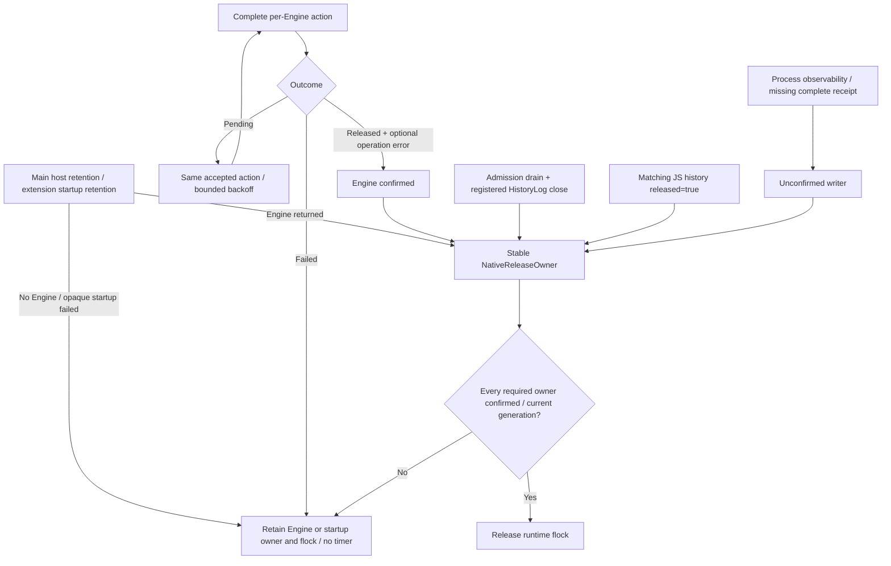

# iOS suspension storage ownership

## Scope

The baseline is Mobile `fcf68bfe917fc7a12a3c0696ac90b5463ae0b724` with Engine
`f44ae136f76a05e642fc22e32b823161f0716cef`.
The current Engine source pin is
`0c972cd97503cad73704933e066c728a38e9585f`, merged by Engine PR306.
Its nested network source is `413531dd7503c87ce89f21b69196f8c26eed909d`.
The historical baseline above remains unchanged.
This change repairs Mobile ownership defects. It does not identify the file in
the original RUNNINGBOARD `0xdead10cc` reports. It does not change the Engine API
or release runtime ownership before Engine completion.

## Ownership

`AppGroupStore/StorageAccess` contains the Foundation admission owner.
The main bridge, Engine host and extension processes use one instance per
process. The Share dependency excludes Expo and Engine. The SwiftPM host uses
the same source through the `SharedStorageAccess` product.

The owner rejects new operations after background admission closes.
It counts an accepted operation until that operation returns.
Each foreground entry creates a generation. A queued writer must present its
original generation before it can access storage. A stale expiration cannot
close a new generation. Cleanup completion waits for operations from its own
or an earlier generation.

| Owner                 | Suspension behavior                                                                                                                    |
| --------------------- | -------------------------------------------------------------------------------------------------------------------------------------- |
| JS history            | Stop leases, retain the connection on close failure, retry its actual close, and reject a late open.                                   |
| Native history        | Close SQLite from `HistoryLog.suspend`; reopen lazily after `onAppear` resumes history.                                                |
| Host acknowledgement  | Complete only for the matching transition with `released=true`. Listener removal does not certify release.                             |
| Native storage        | Retain the native-files background part until accepted calls return.                                                                   |
| Native diagnostics    | Reject new records and discard queued or completed records from old generations.                                                       |
| Payload cache         | Fence deferred fetches and Share file copies at their actual disk entry.                                                               |
| Analytics             | Deny queue writes while suspended and reject delivery acknowledgements from an earlier generation.                                     |
| Share diagnostics     | Fence the recorder generation and stop lock acquisition on suspension or its acquisition deadline.                                     |
| Extension Engine      | Complete the one-shot session through shutdownWithOutcome; retain Engine, file owners and runtime flock until all confirm.             |
| Main Engine           | Use complete suspend/shutdown outcomes through one stable native owner for background, explicit shutdown, destroy and startup failure. |
| Process observability | Keep release unconfirmed. Its independent writers have no recoverable complete close receipt.                                          |

Grant-end and host-acknowledgement reports use OSLog. They do not open an App
Group journal. Quiescing must complete suspend before Mobile reports success.
ShuttingDown alone does not certify suspension.
`NativeReleaseOwner` retains itself independently of its retry closure. Only
Pending schedules another wait, with 100 ms to 5 s backoff. Released preserves
its operation error. Failed remains latched and schedules no wait. Foreground
alone does not establish that a Failed worker recovered.

Each owner acknowledgement carries its transition generation. The final unlock
also checks the closed storage epoch atomically against foreground reopening.
Release reporting uses the system log and does not reopen an App Group journal.
Foreground
invalidates release authority before reopening admission. Accepted Engine
waits run outside that generation lock. Superseded queued lifecycle actions
cannot resume or release the new background transition.

HistoryLog registers its independently owned SQLite connection with the native
storage gate. The gate waits for accepted work and calls the actual closer
before confirming native files. HistoryLog retains itself while SQLite is
open, including after a failed close. A false close result remains unconfirmed.
A stale close request cannot suspend a newer foreground generation. The global
closer preserves the component's explicit suspend flag. Admission-owned LAN
history can reopen lazily after foreground without a transport change.

Share request completion has a separate file-close continuation. The admission
gate retains its context after a false close result. A later positive registry
close executes the continuation once, outside the gate lock. A HistoryLog close
outside the registry requests a fresh registry check after releasing its own
lock. A superseded generation remains unconfirmed. This does not select Share
interruption recovery, cancellation or termination policy.

Diagnostic-only startup also installs process writers under runtime ownership.
The absent process receipt can therefore block an extension Engine start even
without a running main Engine. Removing exclusion requires an explicit process
logging ownership decision. An unconditional unlock is not a valid repair.

### Owner graph

The extension has no JS history owner. It declares native files and process
observability. The main application declares native files, JS history and
process observability. Positive Engine completion never substitutes for any
of these independent file acknowledgements.

The process observability receipt is currently unavailable. Therefore production
handoff remains unconfirmed even when Engine and Mobile files have closed.
This prevents premature unlock; it does not guarantee suspension safety or
eliminate the original crash. Keep the PR blocked on that owner contract.

## Replays

1. Install the project's JavaScript dependencies if the JS replay is required.
2. Run `python3 e2e/ios-suspension/run.py --baseline` to preserve the baseline failure.
3. Run `python3 e2e/ios-suspension/run.py` to check extension storage sources.
4. Run `python3 e2e/ios-suspension/run.py --module-storage` to check the Expo storage sources.
5. Run `node e2e/ios-suspension/run-js.mjs --baseline` to preserve JS ownership failures.
6. Run `node e2e/ios-suspension/run-js.mjs` to check JS history and its suspension subscriber.
7. Run `python3 e2e/ios-suspension/check-builds.py` for nonvisual compilation and existing storage checks.

Use `--output-root <directory>` to retain artifacts outside the default
`e2e/results/ios-suspension` directory. Directory names use timestamps. Concurrent or same-millisecond JS
runs can reuse a directory and overwrite receipts. Run replays serially and
preserve selected output directories before another run.
The build checker selects existing committed, staged, unstaged and untracked
files against the merge base of `--base-ref` (default: the pinned baseline).
Deleted paths are excluded. Its receipt records the resolved base and HEAD.
The native replay preserves compiler output, process exit codes, source hashes
and per-case assertions. It uses actual temporary SQLite data and independent
flock probes. The JS replay adapts the Expo bridge to real `node:sqlite` data.
Its injected close failure leaves the real connection open until retry.

The keyboard diagnostic fixture extracts the production `KeyboardDiagnostics`
class. It changes only the temporary log URL, constructor visibility and queue
barriers. It does not compile or run UIKit or the KeyboardModel UI.
The fixture receipt records these adaptations and the original source hash.
The analytics replay uses the existing SwiftPM binding compatibility types.
It intercepts a synthetic Foundation request with URLProtocol. It sends no
external telemetry. Callback and delivery-queue barriers preserve ordering.

## Acceptance limits

The keyboard.jsonl writer uses the same admission owner at both queue entries.
A queued record retains its original generation. The replay checks both entry
points and confirms that the current visible generation can write again.
This guard changes no synchronization task or transport behavior.

No replay launches an app, simulator, VM or device. No replay accesses a
production App Group, clipboard, profile, keychain or database.
A manual grant and controlled Engine are host mechanisms only.
The controlled Mobile replay does not certify actual UIKit suspension or
actual Rust Engine cleanup.
The full Expo/UIKit app build also requires the matching prepared Engine
binding and framework. An older cached binding is not a valid substitute.

## Complete Engine release results

The merged Engine provides `suspendWithOutcome(deadlineMs:)` and
`shutdownWithOutcome(deadlineMs:)`. Consume each complete result directly:

- `pending`: retain the accepted action and owner; wait again with backoff.
- `released(error:)`: confirm only the Engine obligation and preserve any
  operation error. Await the independent Mobile/native/JS file acknowledgements.
- `failed(error:)`: retain Engine and runtime ownership, stop automatic Pending
  retries and report release unconfirmed. Its nested retryable flag does not
  override the complete result.

The result covers one Engine. It excludes process observability, detached
flushes, other active Engines and Mobile-owned files. `Stopped`, state polling
and arbitrary errors do not establish release. A terminal worker cannot restart
through repeated waits. A retained live closer may support an explicit retry
after its cause is corrected.

The Mobile lifecycle consumes the complete outcome API. Normal main-app
suspension, final shutdown, destroy and returned-Engine startup failure use the
same owner. A one-shot extension confirms final worker destruction before
handoff. No state query or arbitrary error grants release authority.

A startup failure without a returned Engine keeps an explicit unconfirmed host
owner. A context destroyed during startup cannot install a late Engine as a
ready session. Its returned Engine enters final cleanup. Replacement startup
is denied while the previous startup release remains unconfirmed.

Failures before the opaque Engine constructor are tracked by phase. A rejected
ownership acquisition does not become an unknown Engine construction. Once
construction entered and returned no object, replacement remains blocked until
there is a positive failed-start cleanup receipt.

The existing controlled owner and native storage replays do not execute the
Expo bridge or UIKit lifecycle. Record the complete Expo/UIKit build separately
from those replays and from the Engine's actual macOS resource scenarios.

`installProcessObservability` installs a process owner. The Engine binding can
schedule a detached process flush after a lifecycle call. Mobile's best-effort
flush is neither an admission fence nor a process-file close receipt. Do not
replace recoverable suspension with process-observability shutdown without a
source-matched recovery contract. Do not release the runtime flock to work
around this missing acknowledgement.

Build generated declarations and native binaries from the same immutable source
pair. Never combine the new declarations with an older cached framework.
For the Engine's existing non-graphical host/binding acceptance, run
`bash scripts/testing/run-resource-release.sh` in that exact Engine checkout
with `UC_RELEASE_EVIDENCE` set to a fresh artifact directory. Keep its source
hashes, executable hashes, original exit codes and evidence errors. Those
macOS scenarios do not certify a full Mobile lifecycle or the original crash.

## Remaining owner contracts

The merged Engine contract covers the complete per-Engine action. Two independent
prerequisites remain for complete production handoff:

1. Provide a recoverable process owner that closes admission, drains accepted
   writes, joins the relevant file/network workers and returns a complete release
   result. Flush and terminal process shutdown do not supply this contract.
2. Provide a failed-start cleanup result with a retained owner, including failures
   before startup input is taken. A startup error, a joined thread and repeated
   startup suspend are insufficient. Source-matched failure-branch acceptance is
   still required.

These are contract requirements, not available API declarations. This Mobile
change invents no Engine method and selects no logging restart policy. It keeps
both obligations unconfirmed. During context destruction, a missing JS history
acknowledgement also stays unconfirmed; listener removal is not a close receipt.

## Device acceptance

Share repeat appearance remains unverified and open. No automatic retry policy
was selected. Validate explicit continuation or termination before acceptance.

Use an isolated bundle and App Group with synthetic data.
Match Mobile, Engine, dependency, executable and dSYM revisions.
Capture one transition id across background entry, grant expiration, owner
completion and descriptor/lock release. Repeat cold startup, accepted transfer,
keyboard dismissal, background and foreground sequences without a debugger.
Verify data preservation and exclusive runtime ownership after resume.
Keep watchdog, Jetsam, URLSession abort and blob panic results separate.

An accepted syscall or Engine cleanup can outlive a host deadline.
The Mobile owner must retain pending state in that case.
Engine must certify its operations, security leases, databases, blob actors,
redb handles and network-log release before complete acceptance.
Do not infer that certificate from a timeout or a controlled Engine substitute.
